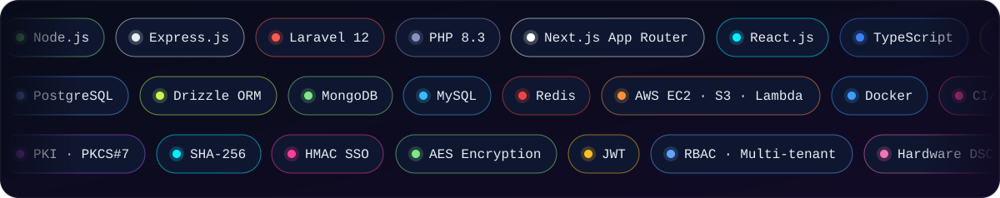
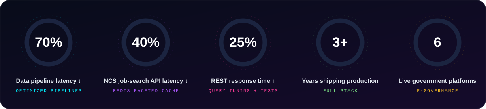

   

   

           <table> <tr> <td></td> <td></td> </tr> <tr> <td></td> <td></td> </tr> <tr> <td></td> <td></td> </tr> </table>           <picture> <source media="(prefers-color-scheme: dark)" srcset="https://raw.githubusercontent.com/Prithiviraj69/Prithiviraj69/output/github-snake-dark.svg"/> <source media="(prefers-color-scheme: light)" srcset="https://raw.githubusercontent.com/Prithiviraj69/Prithiviraj69/output/github-snake.svg"/>  </picture>  

